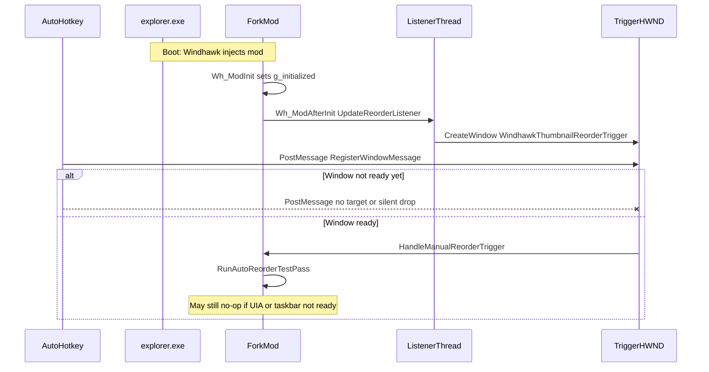

# Handoff: PostMessage trigger unreliable at Windows startup

**Repo:** https://github.com/codychen98/windhawk-mods  
**Package path:** `handoff/taskbar-thumbnail-reorder-postmessage/`  
**Audience:** Investigate and fix the root cause in the fork mod. Prefer a durable fix over AHK sleep hacks.

---

## HARD GATE — do not debug until intake is complete

**Stop.** Do not hypothesize root cause, do not edit code, do not propose AHK sleeps, and do not write a fix until **all** of the following are actually read (not merely linked).

### Required intake checklist (must complete first)

Open and read every file below. Prefer the repo tree / blob URLs (this package is on GitHub; local `roadmap/` is gitignored and unavailable to public-only agents).

| # | Required file | GitHub URL |
|---|---------------|------------|
| 1 | This brief | https://github.com/codychen98/windhawk-mods/blob/main/handoff/taskbar-thumbnail-reorder-postmessage/handoff.md |
| 2 | Package folder (list + open siblings) | https://github.com/codychen98/windhawk-mods/tree/main/handoff/taskbar-thumbnail-reorder-postmessage |
| 3 | Fork mod (v1.3.16, what the user runs) | https://github.com/codychen98/windhawk-mods/blob/main/handoff/taskbar-thumbnail-reorder-postmessage/taskbar-thumbnail-reorder-fork.wh.cpp |
| 4 | Code map | https://github.com/codychen98/windhawk-mods/blob/main/handoff/taskbar-thumbnail-reorder-postmessage/NOTES_CODEMAP.md |
| 5 | Live Windhawk settings | https://github.com/codychen98/windhawk-mods/blob/main/handoff/taskbar-thumbnail-reorder-postmessage/mod_settings.json |
| 6 | AHK startup trigger | https://github.com/codychen98/windhawk-mods/blob/main/handoff/taskbar-thumbnail-reorder-postmessage/ahk_startup_trigger.ahk |
| 7 | **Original non-fork mod** (upstream baseline) | https://github.com/codychen98/windhawk-mods/blob/main/mods/taskbar-thumbnail-reorder.wh.cpp |

**Original / non-fork location:** `mods/taskbar-thumbnail-reorder.wh.cpp` in this same repo (m417z Taskbar Thumbnail Reorder **1.1.5** — manual drag only; **no** auto-reorder, **no** PostMessage trigger, **no** listener thread). You **must** read it and contrast with the fork so you know which behavior is fork-added vs upstream.

### First reply after intake (before any fix)

Your first substantive reply must include a short **Intake confirmation** block:

1. List each required file above and confirm it was read.
2. One paragraph: what the fork adds vs the original `mods/taskbar-thumbnail-reorder.wh.cpp`.
3. One paragraph: how PostMessage is supposed to flow (AHK → registered message → trigger HWND → `RunAutoReorderTestPass`).
4. Only then start root-cause analysis and deliverables.

If any required file could not be fetched, **stop and say which ones are missing** — do not invent contents.

---

## Symptom

At Windows login the user:

1. Starts Floorp (Firefox fork) first so windows/tabs restore.
2. After windows appear loaded, runs AutoHotkey 1.1:

```autohotkey
triggerMsg := DllCall("RegisterWindowMessage", "Str", "Windhawk.TaskbarThumbnailReorder.Trigger")
PostMessage, %triggerMsg%, 0, 0,, ahk_class WindhawkThumbnailReorderTrigger
```

**Most startups:** thumbnail reorder does not happen.  
**After waiting and pressing F1** (same PostMessage again via AHK): usually works.  
**Sometimes:** even the manual F1 PostMessage does nothing.

Important distinction:

- Mod setting `hotkeyEnabled` is **0**. The mod’s own F1 / `RegisterHotKey` path is off.
- Historical note: the user previously retried by pressing F1 in an AHK script that called the same `PostMessage`. The checked-in [`ahk_startup_trigger.ahk`](ahk_startup_trigger.ahk) now runs elevated and calls `TriggerReorder()` once at script start (after Floorp windows are loaded).
- Mod setting `autoReorderOnModLoad` is **0**. The one-shot timer pass is not used; reorder is expected only via PostMessage.

See [`ahk_startup_trigger.ahk`](ahk_startup_trigger.ahk) and [`mod_settings.json`](mod_settings.json).

---

## Environment

| Item | Value |
|------|--------|
| OS | Windows 11 (taskbar / Explorer host) |
| Injected process | `explorer.exe` (Windhawk) |
| Mod | Fork `@id taskbar-thumbnail-reorder-fork` **v1.3.16** |
| Source in this package | [`taskbar-thumbnail-reorder-fork.wh.cpp`](taskbar-thumbnail-reorder-fork.wh.cpp) |
| Upstream baseline (no auto-reorder / no trigger) | [`../../mods/taskbar-thumbnail-reorder.wh.cpp`](../../mods/taskbar-thumbnail-reorder.wh.cpp) (m417z 1.1.5) |
| Target app in rules | `floorp.exe` |
| External trigger | `externalPostMessageTriggerEnabled: 1` |
| AHK | 1.1, startup script (elevated); calls `TriggerReorder()` once when run |

---

## Repo map (what you can read)

This package is committed so models with only public-fork access can work. Local `roadmap/` is gitignored and is **not** on GitHub.

| File | Role |
|------|------|
| [`handoff.md`](handoff.md) | This brief |
| [`taskbar-thumbnail-reorder-fork.wh.cpp`](taskbar-thumbnail-reorder-fork.wh.cpp) | Exact single-file mod the user pastes into Windhawk |
| [`mod_settings.json`](mod_settings.json) | Live Windhawk settings snapshot |
| [`ahk_startup_trigger.ahk`](ahk_startup_trigger.ahk) | AHK 1.1 trigger used at startup |
| [`NOTES_CODEMAP.md`](NOTES_CODEMAP.md) | Line anchors for trigger / listener / pass |
| [`mods/taskbar-thumbnail-reorder.wh.cpp`](../../mods/taskbar-thumbnail-reorder.wh.cpp) | **Original non-fork** upstream mod (required contrast) |

Folder on GitHub: https://github.com/codychen98/windhawk-mods/tree/main/handoff/taskbar-thumbnail-reorder-postmessage

---

## Investigation mandate

0. Complete the **HARD GATE** intake (including original `mods/taskbar-thumbnail-reorder.wh.cpp`) before any analysis or code changes.
1. Dig into the fork source: listener thread, hidden trigger HWND, registered message, `RunAutoReorderTestPass`, apply path.
2. Separate **message delivery failure** from **pass ran but produced no visible reorder**.
3. Explain intermittent manual failure, not only the startup race.
4. Fix the **root cause** in the mod (and tighten the external-trigger contract if needed). Do not stop at “add Sleep 30s in AHK” unless that is explicitly labeled a temporary workaround paired with a real fix.
5. Add or improve Windhawk log lines so delivery vs pass vs apply are distinguishable with logging enabled.

---

## Suspected failure modes (confirm or refute)



Buckets to investigate:

1. **Delivery race** — AHK posts before `WindhawkThumbnailReorderTrigger` exists (common at login).
2. **Silent PostMessage miss** — `ahk_class` finds nothing; AHK does not check `ErrorLevel` / `WinExist`.
3. **Delivery OK, pass no-ops** — trigger received but early return (rules/`g_initialized`), or Floorp tabs/UIA/taskbar not ready yet.
4. **Listener not running** — `CreateThread` failed, settings not enabling PostMessage, mod not injected yet, thread exited.
5. **Intermittent manual fail** — thread/HWND destroyed during settings reload, wrong Explorer process, apply failed after a successful trigger log.

Prior art in this fork: v1.2.4 moved hotkey/`GetMessage` onto a dedicated listener thread because WM_HOTKEY was delivered to the wrong queue. PostMessage uses the same hidden window on that thread (`ReorderListenerThreadProc`). Treat that history as relevant, not as proof PostMessage delivery is solid.

---

## Code anchors (fork v1.3.16)

See [`NOTES_CODEMAP.md`](NOTES_CODEMAP.md) for a fuller map. Short list:

- `RunAutoReorderTestPass` — early exits for invalid rules / empty apps / not initialized
- `HandleManualReorderTrigger` / `ReorderTriggerWndProc` — PostMessage and hotkey entry
- `ReorderListenerThreadProc` — `RegisterWindowMessage`, `CreateWindowExW` (hidden popup, not `HWND_MESSAGE`), message pump
- `UpdateReorderListener` — start/stop listener from `Wh_ModAfterInit` and `Wh_ModSettingsChanged`
- Constants: class `WindhawkThumbnailReorderTrigger`, message name `Windhawk.TaskbarThumbnailReorder.Trigger`

---

## Required deliverables

1. **Root-cause writeup** — which bucket(s) are real, with evidence from code and suggested log observations.
2. **Minimal fix** in `taskbar-thumbnail-reorder-fork.wh.cpp` (or a clear patch description ready to paste into Windhawk).
3. **Diagnostic logs** — e.g. window ready, message received, pass start/skip reason, apply result.
4. **Robust trigger contract** if delivery is racy (mod-side retry/ack, or documented ready signal)—not only client-side sleeps.
5. **How to validate** — startup path + delayed manual PostMessage + logging checklist.
6. **Better pre-paste testing** — propose ways to validate the fix *before* the user copy-pastes into Windhawk and reboots / manually smoke-tests. Prefer something more automatic or higher-confidence than “paste → compile in Windhawk → restart Explorer → hope.” Examples to consider (pick what is realistic for a Windhawk `/explorer.exe` mod; invent better if you have them):
   - Extractable unit/integration tests for listener HWND creation, registered-message dispatch, and `RunAutoReorderTestPass` early-exit paths (mock or harness outside Explorer).
   - A small standalone Win32 harness that hosts the same trigger window + message contract and is driven by AHK/`PostMessage` with assertions.
   - Compile-time or static checks that do not require a full login session.
   - Scripted DebugView / Windhawk-log expectations the user can run once with logging on.
   - Clearly state what still **must** be verified on a real Windows desktop (taskbar thumbnail order, Floorp UIA, Explorer injection) vs what can be automated earlier.

---

## Out of scope for the investigator (unless needed for the fix)

- Rewriting the full auto-reorder engine.
- Submitting the fork to the official Windhawk mods catalog.
- Changing upstream `mods/taskbar-thumbnail-reorder.wh.cpp` in place of the fork.
