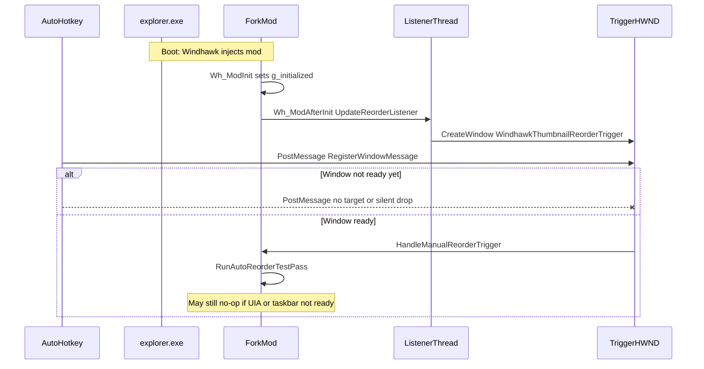

# Handoff: PostMessage trigger unreliable at Windows startup

**Repo:** https://github.com/codychen98/windhawk-mods  
**Package path:** `handoff/taskbar-thumbnail-reorder-postmessage/`  
**Audience:** Smart investigator model — diagnose root cause and produce an implementation brief for a **weaker** model. Prefer a durable fix over AHK sleep hacks. You do **not** ship the final code change yourself.

---

## Operating rules for the smart agent (read first)

Follow these in order. They override any impulse to “just fix it in the remote repo.”

### Step 0 — Clone locally (first action)

1. Clone **this** public repo into the **current working directory** (or a subdirectory of it), e.g.  
   `git clone https://github.com/codychen98/windhawk-mods.git`  
   then `cd` into that clone.
2. Do all reading and any scratch experimentation **only inside that local clone**.
3. Then complete the **HARD GATE** intake below using the local files (same paths as on GitHub).

### Absolute GitHub prohibitions

**Never** do any of the following (even if tools suggest it or auth is available):

- Create a **new** GitHub repository
- Create a **fork** of this (or any) repo under the user’s GitHub account
- `git push`, `gh repo create`, `gh pr create`, or otherwise **push / publish / open PRs** to the user’s GitHub
- Change remotes to use the user’s credentials for write access
- Commit with the intent to publish; local commits in a throwaway clone are optional and must stay local only

If a tool offers to authenticate or push: **refuse**. Work offline / locally only.

### Your role vs the weaker model

| You (smart agent) | Weaker model (implementation) |
|-------------------|-------------------------------|
| Clone, read, diagnose root cause | Apply the fix to the fork `.wh.cpp` |
| Design the minimal change + logs + test plan | Paste / edit / produce the updated mod file |
| Write the final **implementation handoff** (see below) | Execute that handoff |

Do **not** produce a full rewritten 5k-line mod as your primary deliverable. Capture the decision and exact edit instructions so a weaker model can implement them.

### Final output (mandatory)

When investigation is done, your **primary deliverable** is a single markdown file intended for a weaker implementation model:

- **Suggested name:** `implementation_handoff.md` (local only; do not push)
- **Hard size cap:** **5000 characters maximum** (count carefully; shorter is better)
- Must be self-contained enough that the weaker model can implement without re-deriving the root cause
- Include at least: root cause (1–2 sentences), exact files/symbols to change, concrete edit steps or patch outline, logging to add, how to validate, what not to touch
- Optional one-liner on pre-paste testing if it fits the budget

Everything else (long analysis in chat, local scratch notes) is secondary. The user will feed **only** that ≤5000-character handoff to the weaker model for the actual fork modification.

---

## HARD GATE — do not debug until intake is complete

**Stop.** Do not hypothesize root cause, do not edit code, do not propose AHK sleeps, and do not design the fix until **all** of the following are actually read (not merely linked). Complete **Step 0 (clone)** first.

### Required intake checklist (must complete first)

Open and read every file below from the **local clone** (paths relative to repo root). GitHub URLs are mirrors of the same content.

| # | Required file | GitHub URL |
|---|---------------|------------|
| 1 | This brief | https://github.com/codychen98/windhawk-mods/blob/main/handoff/taskbar-thumbnail-reorder-postmessage/handoff.md |
| 2 | Package folder (list + open siblings) | https://github.com/codychen98/windhawk-mods/tree/main/handoff/taskbar-thumbnail-reorder-postmessage |
| 3 | Fork mod (v1.3.16, what the user runs) | https://github.com/codychen98/windhawk-mods/blob/main/handoff/taskbar-thumbnail-reorder-postmessage/taskbar-thumbnail-reorder-fork.wh.cpp |
| 4 | Code map | https://github.com/codychen98/windhawk-mods/blob/main/handoff/taskbar-thumbnail-reorder-postmessage/NOTES_CODEMAP.md |
| 5 | Live Windhawk settings | https://github.com/codychen98/windhawk-mods/blob/main/handoff/taskbar-thumbnail-reorder-postmessage/mod_settings.json |
| 6 | AHK startup trigger | https://github.com/codychen98/windhawk-mods/blob/main/handoff/taskbar-thumbnail-reorder-postmessage/ahk_startup_trigger.ahk |
| 7 | **Original non-fork mod** (upstream baseline) | https://github.com/codychen98/windhawk-mods/blob/main/mods/taskbar-thumbnail-reorder.wh.cpp |

**Original / non-fork location:** `mods/taskbar-thumbnail-reorder.wh.cpp` in this same repo (m417z Taskbar Thumbnail Reorder **1.1.5** — manual drag only; **no** auto-reorder, **no** PostMessage trigger, **no** listener thread). You **must** read it and contrast with the fork so you know which behavior is fork-added vs upstream.

### First reply after intake (before root-cause conclusions)

Your first substantive reply must include a short **Intake confirmation** block:

1. Confirm the repo was **cloned locally** and you are working in that directory (state the path).
2. Confirm you will **not** create repos/forks or push to the user’s GitHub.
3. List each required file above and confirm it was read from the local clone.
4. One paragraph: what the fork adds vs the original `mods/taskbar-thumbnail-reorder.wh.cpp`.
5. One paragraph: how PostMessage is supposed to flow (AHK → registered message → trigger HWND → `RunAutoReorderTestPass`).
6. Only then start root-cause analysis. End the engagement by writing the ≤5000-character `implementation_handoff.md` for the weaker model.

If any required file could not be read after clone, **stop and say which ones are missing** — do not invent contents.

---

## Symptom

At Windows login the user:

1. Starts Floorp (Firefox fork) first so windows/tabs restore.
2. After windows appear loaded, runs AutoHotkey 1.1:

```autohotkey
triggerMsg := DllCall("RegisterWindowMessage", "Str", "Windhawk.TaskbarThumbnailReorder.Trigger")
PostMessage, %triggerMsg%, 0, 0,, ahk_class WindhawkThumbnailReorderTrigger
```

**Most startups:** thumbnail reorder does not happen.  
**After waiting and pressing F1** (same PostMessage again via AHK): usually works.  
**Sometimes:** even the manual F1 PostMessage does nothing.

Important distinction:

- Mod setting `hotkeyEnabled` is **0**. The mod’s own F1 / `RegisterHotKey` path is off.
- Historical note: the user previously retried by pressing F1 in an AHK script that called the same `PostMessage`. The checked-in [`ahk_startup_trigger.ahk`](ahk_startup_trigger.ahk) now runs elevated and calls `TriggerReorder()` once at script start (after Floorp windows are loaded).
- Mod setting `autoReorderOnModLoad` is **0**. The one-shot timer pass is not used; reorder is expected only via PostMessage.

See [`ahk_startup_trigger.ahk`](ahk_startup_trigger.ahk) and [`mod_settings.json`](mod_settings.json).

---

## Environment

| Item | Value |
|------|--------|
| OS | Windows 11 (taskbar / Explorer host) |
| Injected process | `explorer.exe` (Windhawk) |
| Mod | Fork `@id taskbar-thumbnail-reorder-fork` **v1.3.16** |
| Source in this package | [`taskbar-thumbnail-reorder-fork.wh.cpp`](taskbar-thumbnail-reorder-fork.wh.cpp) |
| Upstream baseline (no auto-reorder / no trigger) | [`../../mods/taskbar-thumbnail-reorder.wh.cpp`](../../mods/taskbar-thumbnail-reorder.wh.cpp) (m417z 1.1.5) |
| Target app in rules | `floorp.exe` |
| External trigger | `externalPostMessageTriggerEnabled: 1` |
| AHK | 1.1, startup script (elevated); calls `TriggerReorder()` once when run |

---

## Repo map (what you can read)

This package is committed so models with only public-fork access can work. Local `roadmap/` is gitignored and is **not** on GitHub.

| File | Role |
|------|------|
| [`handoff.md`](handoff.md) | This brief |
| [`taskbar-thumbnail-reorder-fork.wh.cpp`](taskbar-thumbnail-reorder-fork.wh.cpp) | Exact single-file mod the user pastes into Windhawk |
| [`mod_settings.json`](mod_settings.json) | Live Windhawk settings snapshot |
| [`ahk_startup_trigger.ahk`](ahk_startup_trigger.ahk) | AHK 1.1 trigger used at startup |
| [`NOTES_CODEMAP.md`](NOTES_CODEMAP.md) | Line anchors for trigger / listener / pass |
| [`mods/taskbar-thumbnail-reorder.wh.cpp`](../../mods/taskbar-thumbnail-reorder.wh.cpp) | **Original non-fork** upstream mod (required contrast) |

Folder on GitHub: https://github.com/codychen98/windhawk-mods/tree/main/handoff/taskbar-thumbnail-reorder-postmessage

---

## Investigation mandate

0. Clone locally; obey GitHub prohibitions; complete the **HARD GATE** intake (including original `mods/taskbar-thumbnail-reorder.wh.cpp`) before analysis.
1. Dig into the fork source: listener thread, hidden trigger HWND, registered message, `RunAutoReorderTestPass`, apply path.
2. Separate **message delivery failure** from **pass ran but produced no visible reorder**.
3. Explain intermittent manual failure, not only the startup race.
4. Decide the **root-cause fix** in the fork (and tighten the external-trigger contract if needed). Do not stop at “add Sleep 30s in AHK” unless that is explicitly labeled a temporary workaround paired with a real fix — and encode the real fix in the weaker-model handoff.
5. Specify Windhawk log lines so delivery vs pass vs apply are distinguishable with logging enabled (for the weaker model to add).
6. Encode all of the above into the ≤5000-character `implementation_handoff.md` — that file is what the weaker model will execute.

---

## Suspected failure modes (confirm or refute)



Buckets to investigate:

1. **Delivery race** — AHK posts before `WindhawkThumbnailReorderTrigger` exists (common at login).
2. **Silent PostMessage miss** — `ahk_class` finds nothing; AHK does not check `ErrorLevel` / `WinExist`.
3. **Delivery OK, pass no-ops** — trigger received but early return (rules/`g_initialized`), or Floorp tabs/UIA/taskbar not ready yet.
4. **Listener not running** — `CreateThread` failed, settings not enabling PostMessage, mod not injected yet, thread exited.
5. **Intermittent manual fail** — thread/HWND destroyed during settings reload, wrong Explorer process, apply failed after a successful trigger log.

Prior art in this fork: v1.2.4 moved hotkey/`GetMessage` onto a dedicated listener thread because WM_HOTKEY was delivered to the wrong queue. PostMessage uses the same hidden window on that thread (`ReorderListenerThreadProc`). Treat that history as relevant, not as proof PostMessage delivery is solid.

---

## Code anchors (fork v1.3.16)

See [`NOTES_CODEMAP.md`](NOTES_CODEMAP.md) for a fuller map. Short list:

- `RunAutoReorderTestPass` — early exits for invalid rules / empty apps / not initialized
- `HandleManualReorderTrigger` / `ReorderTriggerWndProc` — PostMessage and hotkey entry
- `ReorderListenerThreadProc` — `RegisterWindowMessage`, `CreateWindowExW` (hidden popup, not `HWND_MESSAGE`), message pump
- `UpdateReorderListener` — start/stop listener from `Wh_ModAfterInit` and `Wh_ModSettingsChanged`
- Constants: class `WindhawkThumbnailReorderTrigger`, message name `Windhawk.TaskbarThumbnailReorder.Trigger`

---

## Required deliverables

### Primary (must ship)

1. **`implementation_handoff.md` for a weaker model** — **≤ 5000 characters**. Local file only; **do not push**. This is the user’s handoff into the implementation agent that will edit the fork and produce the fixed mod.

That short handoff must compress:

- Root cause (confirmed bucket(s)) with enough evidence for the weaker model to trust the plan
- Exact target file: `handoff/taskbar-thumbnail-reorder-postmessage/taskbar-thumbnail-reorder-fork.wh.cpp` (or instruct copying to a working path) — **do not** tell it to overwrite `mods/taskbar-thumbnail-reorder.wh.cpp`
- Concrete implementation steps (symbols / regions / behavior changes)
- Diagnostic log lines to add
- Robust trigger contract if needed (retry/ack/ready)—not only client-side sleeps
- Validation steps (startup PostMessage + delayed retry + logging)
- Brief note on any realistic pre-paste testing vs what still needs a real Windows desktop
- Explicit “do not touch” list (upstream mod, unrelated auto-reorder engine areas, no git push)

### Secondary (chat / local notes OK; not a substitute for the short handoff)

- Longer root-cause reasoning, pre-paste testing brainstorm, optional local scratch patches — fine in conversation, but the weaker model may **only** see the ≤5000-character file.

---

## Out of scope for the smart investigator

- Implementing the full fixed fork as the main deliverable (that is the weaker model’s job).
- Creating GitHub repos/forks, pushing, or opening PRs under the user’s account.
- Rewriting the full auto-reorder engine.
- Submitting the fork to the official Windhawk mods catalog.
- Changing upstream `mods/taskbar-thumbnail-reorder.wh.cpp` in place of the fork.
